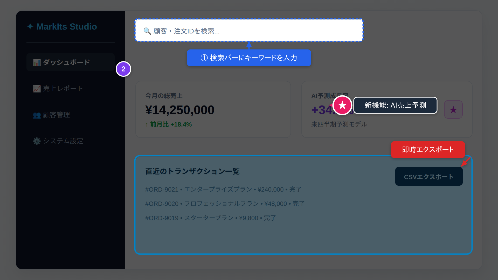
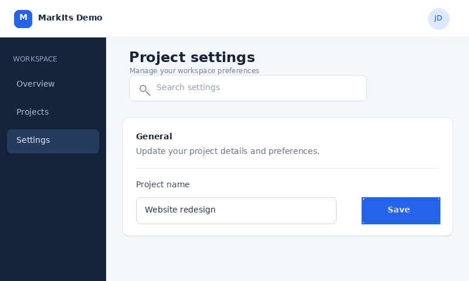
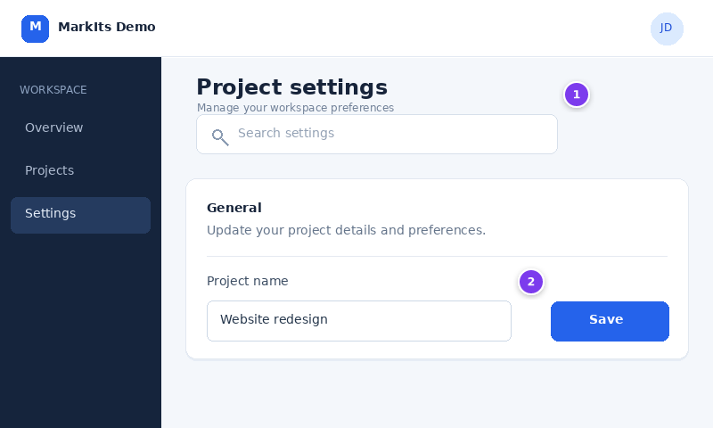

# MarkIts

<p align="center">
  
</p>

**MarkIts は、画面を撮り、伝えたい場所にマークを付け、操作手順を画像で共有するためのスクリーンショットアプリです。**

UI要素に吸い付くスナップ、多彩な注釈、マウスカーソル付き撮影、操作記録を使った再撮影で、操作マニュアルや問い合わせ、レビューに使う画像を作れます。日常の撮影・編集はデスクトップアプリで、AI連携や自動処理はCLIで利用できます。

<p align="center">
  
</p>

## 主な特徴

- **ウィンドウ・画面全体を撮影** — キャプチャボタンやグローバルショートカットから撮影し、そのまま編集できます。
- **UI要素にスナップ** — 取得したボタンや入力欄などの位置に合わせてマークを配置。細かな位置合わせを手助けします。
- **多彩なマーキング** — 直線・曲線矢印、番号付き矢印、吹き出し、ピン、ラベル、手順バッジ、矩形、円、スポットライト、モザイクなどを使えます。
- **必要な部分を切り抜き** — 自由なクロップに加え、解像度・比率プリセットやマークの範囲に合わせた切り抜きに対応します。
- **撮影履歴から再編集** — ホームの履歴から画像を開き、注釈や切り抜きを調整できます。
- **操作を記録して再撮影** — 対象ウィンドウの操作と撮影タイミングを記録し、操作を再生してスクリーンショットを撮り直せます。
- **マウスカーソル付き撮影（Windows）** — ポインタの位置も含めて、操作箇所を伝える画像を撮影できます。
- **日本語・英語のUI** — 設定から表示言語を切り替えられます。

## インストール

[GitHub Releases](https://github.com/tamon-ishii/markits/releases) から、お使いのOS向けの**デスクトップ版**をダウンロードしてください。

| OS | パッケージ | インストール方法 |
| --- | --- | --- |
| Windows | `*-setup.exe` | セットアップウィザードを実行 |
| macOS | `*.dmg` | 開いてApplicationsへ移動 |
| Debian / Ubuntu | `*.deb` | `sudo apt install ./<package>.deb` |
| Fedoraなど | `*.rpm` | `sudo dnf install ./<package>.rpm` |
| その他のLinux | `*.AppImage` | 実行権限を付けて起動 |

Windows版はインストール時にログイン時の自動起動を登録し、次回ログインからトレイに常駐します。エディタを閉じた後も撮影ショートカットを利用できます。終了する場合はトレイメニューから終了してください。

自動起動の解除やビルド方法は [インストールガイド](docs/installation.md) を参照してください。

## 基本の使い方

1. MarkItsを起動し、**キャプチャ**を押すか、設定した撮影ショートカットを押します。
2. 撮影するウィンドウをクリックするか、画面全体の撮影を選びます。
3. エディタで矢印、枠、テキスト、手順番号などを追加します。**スナップ**を有効にすると、検出されたUI要素に合わせて配置できます。
4. **クロップ**で必要な範囲に切り抜きます。**マーク枠**で注釈の範囲に合わせることもできます。
5. **コピー**でクリップボードへ、**保存**でPNG・WebP・JPEG XLへ書き出します。保存形式は右側のパネルで選べます。過去の画像はホームのキャプチャ履歴から開けます。

画像ファイルへの保存では、注釈・モザイク・クロップを反映した画像だけを書き出し、元画像・UIMap・操作記録などの再編集メタデータを含めません。WebP・JPEG XLはロスレス保存です。再編集やクロップの解除、再撮影にはアプリ内の履歴を使ってください。

既存の画像を編集する場合は、**開く**から読み込んでください。

撮影ショートカットは設定から `PrintScreen`、`Alt+PrintScreen`、`Ctrl+Shift+S` を選べます。他のアプリと競合する場合は別のキーに変更してください。UIスナップの検出範囲は、対象アプリやOSのアクセシビリティ対応によって異なります。

### マウスカーソルを含めて撮る（Windows）

撮影画面で **マウスカーソルを含める** を有効にして対象を選択します。カーソルを写したい位置へ移動し、撮影ショートカットをもう一度押すと撮影できます。

### 操作を記録して、同じ手順を撮り直す

**操作を記録**から対象ウィンドウを選び、操作しながら必要な場面で撮影キーを押します。終了時に **終了して画像を保存** を選びます。操作記録を含む画像を開くと、**再撮影**から記録した操作を再生して撮り直せます。

操作記録はクリック・キー入力・スクロールなどの操作データです。再撮影では対象アプリを実際に操作するため、撮り直す前にアプリを開始時の状態へ戻してください。ネイティブ入力の監視にはOS側の権限が必要になる場合があり、Linuxでの操作記録は現在X11環境が対象です。

## マーキングの例

| 用途 | ツール |
| --- | --- |
| 操作する場所を指す | 矢印、曲線矢印、ピンタグ |
| 操作手順を示す | ステップ矢印、バッジ |
| 説明を添える | コールアウト、ラベル |
| 対象を囲む・目立たせる | 矩形、角丸矩形、円形、スポットライト、ブルズアイ |
| 画像の一部を隠す | モザイク |
| 領域を分ける | 区切り線 |





## AI連携のためのMarkIts CLI

MarkItsには、デスクトップアプリとは別に `markits` CLIがあります。AIエージェントやスクリプトから撮影・注釈付けを実行できます。

UI情報（UIMap）をPNGに埋め込むことで、AIは要素名や役割を確認し、ボタンなどの名前を指定してマークを付けられます。

```sh
# 画面を撮影し、検出したUI情報をPNGに埋め込む
markits capture screen.png --detect-ui

# AIが扱いやすいJSONでUI要素を取得
markits uimap screen.png --json

# UI要素名を指定して枠を付ける
markits annotate screen.png --target "保存" --mark rect -o annotated.png

# 手順番号を付ける
markits annotate screen.png --target "保存" --mark badge --step 1 -o step1.png

# 対象の周辺だけを注釈付きで切り抜く
markits annotate screen.png --target "保存" --mark rect --crop --crop-margin 16 -o detail.png
```

`--target` には画像内のUIMapに含まれる名前を指定します。対象アプリによって取得できる名前は異なります。

### 自動処理・一括生成

```sh
# 複数の注釈をJSONからまとめて追加
markits annotate-batch screen.png examples/batch_marks.json --template examples/team_style.json -o annotated.png

# 3秒後から1秒間隔で3枚撮影
markits capture-series capture.png --delay-ms 3000 --count 3 --interval-ms 1000

# JSONからSVGを生成
markits render input.json > overlay.svg

# 画像に注釈を重ねてPNGを生成
markits render input.json --image screen.png --output annotated.png

# 入力を検証
markits validate input.json --image screen.png

# AI向けマニュアルとコマンド一覧
markits manual
markits --help
```

### 既存画像から再編集メタデータを除去

```sh
markits strip-metadata private.png -o share.png
markits strip-metadata private.webp -o share.webp
markits strip-metadata private.jxl -o share.jxl
```

元画像・クロップ情報・UIMap・操作記録・注釈などのMarkIts用メタデータを除去します。画像の圧縮データは再エンコードせず、表示内容を維持します。出力先には元画像と別のファイルを指定してください。他のアプリのメタデータやカラープロファイルは維持します。

CLIバイナリは [GitHub Releases](https://github.com/tamon-ishii/markits/releases) から取得するか、リポジトリのルートでビルドできます。

```sh
cargo build --release -p markits
```

生成先は `target/release/markits`（Windowsでは `markits.exe`）です。詳細は [AI向けCLIマニュアル](docs/AI_MANUAL.md)、[JSONスキーマ](markits.schema.json)、[サンプル](examples) を参照してください。

## 開発

デスクトップアプリはRust・Tauri 2・TypeScript・Viteで構成されています。Rust、Node.js、および各OS向けのTauriビルド環境を用意してください。

```sh
cd apps/desktop
npm ci
npm run tauri dev
```

配布パッケージのビルド方法は [インストールガイド](docs/installation.md)、翻訳の追加方法は [多言語対応ガイド](docs/i18n.md) を参照してください。

## ライセンス

MIT
